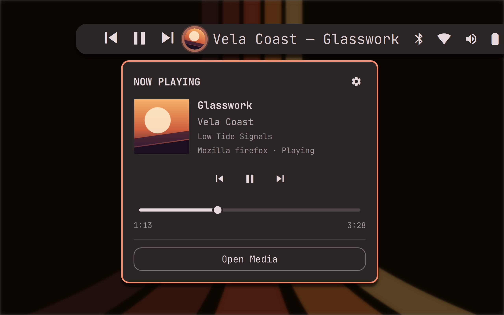
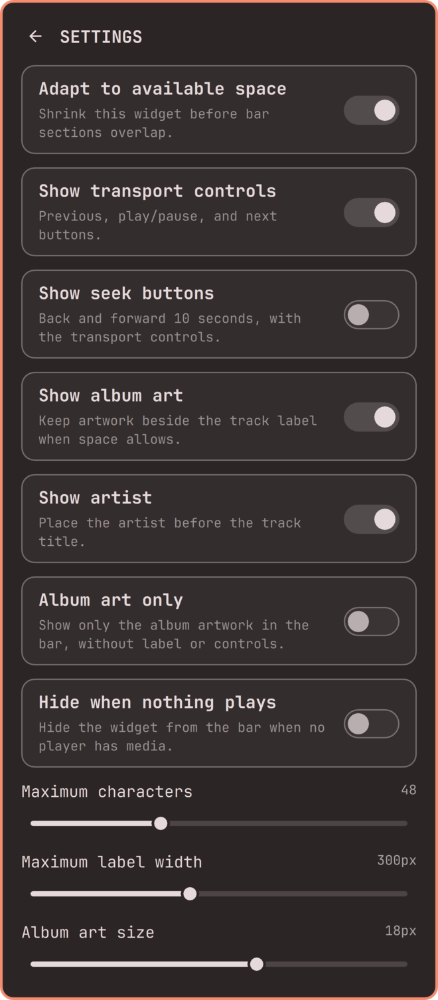
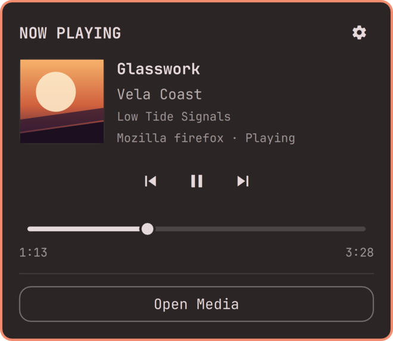

# Media play control for Omarchy

A native Quattro/Quickshell now-playing widget for the Omarchy bar, with media
controls, live album art, and artist/title details:



`previous` · `play/pause` · `next` · `album art` · `artist — title`

https://github.com/user-attachments/assets/74249060-8b5e-49d5-ab3b-7c8be345209b

Forty seconds of the plugin in a real Omarchy session (`demo/demo.mp4`): the disc
turning while a track plays, the "Now playing" card with its transport and
progress bar, and the settings screen being changed live, with the track's audio
removed.

The artwork is always the same disc, whether or not the player has a cover:
masked to a circle inside a two-pixel ring of the theme accent, with a soft
accent halo behind it while a track plays. With a cover the disc turns once
every twelve seconds; without one, or with one Qt cannot decode, a smaller
theme-accent music note takes the cover's place in the same ring and turns at
the same speed. On pause the disc holds the angle; nothing snaps back, and the
note settles upright so a stopped player never looks like a broken icon. The
spin stops when the bar is hidden behind a fullscreen window and when
animations are off (`omarchy toggle animations`), which is the shell's own
reduced-motion switch.

This is a fork of [Media Controls + Album Art](https://github.com/crmne/omarchy-mpris)
by [Carmine Paolino](https://github.com/crmne), used under the MIT license. The
fork renames the widget, moves the appearance settings onto their own screen
behind a settings icon, swaps the mouse buttons, adds an album-art-only bar
mode, and puts transport controls and a seekable progress bar on the
"Now playing" screen. The playlist logic, album-art helper, adaptive bar
sizing, and the rest of the original design are unchanged.

Optional seek buttons go back and forward 10 seconds:
`previous` · `back 10 s` · `play/pause` · `forward 10 s` · `next`. Turn them on
with "Show seek buttons" in the settings screen. They are disabled when the
player does not support seeking.

On crowded horizontal bars, the widget adapts independently on each monitor.
It shortens the label first, then drops previous/next and the seek buttons,
play/pause, and artwork as necessary so it gives space back before the bar
sections overlap. The full track details remain available in the tooltip.

Adaptive sizing measures the visible slots in each bar window, including on
hosts that expose the restricted plugin bar API. It works in every section of
Omarchy 4.5's bar: in the left and right sections, in `centerEnd` up to the
right section and in `centerBegin` up to the left one, and in the centered
`center` box, which grows both ways, with twice the room on its tighter side.
Where a display notch moves the center sections beside the right one, all of
them share the room up to the left section. In the tray's drawer, and on bars
it cannot measure, the widget keeps its full layout. If even the compact
control cannot fit, the widget temporarily hides until space is available
again.

It works with Spotify and other Linux media players that expose the standard
MPRIS interface. The widget uses Quickshell's MPRIS service directly: it does
not poll `playerctl` or depend on the old Waybar scripts. It also works on custom or cloned bars, which do not receive
the shell's plugin services: there the widget runs its own copy of the
service.

## Install

```bash
omarchy plugin add https://github.com/dealenx/omarchy-media-play-control.git --enable --yes
omarchy bar move dealenx.media-play-control --section right --before omarchy.tray
```

## Migrating from Media Controls + Album Art

The upstream plugin uses the id `crmne.mpris`, so the two cannot be installed
side by side. To switch over:

```bash
omarchy plugin remove crmne.mpris --yes
omarchy plugin add https://github.com/dealenx/omarchy-media-play-control.git --enable --yes
omarchy bar move dealenx.media-play-control --section right --before omarchy.tray
```

Removing a plugin leaves its bar entry behind in `~/.config/omarchy/shell.json`.
After the new widget is placed, delete that leftover `crmne.mpris` object from
the `bar.layout` array by hand, then run `omarchy-shell shell rescanPlugins`.
Settings you had set on the old entry (`maxCharacters`, `maxLabelWidth`,
`showAlbumArt`, and so on) are stored on that entry, so copy the keys you want
to keep onto the new one before deleting it.

## Requirements

- Omarchy Quattro with its Quickshell-based shell.
- At least one media player exposing the standard MPRIS interface.
- `/usr/bin/python3` for the album-art helper. No extra packages.

This plugin uses Quickshell's MPRIS service directly and does not require
`playerctl`.

## Mouse and click behavior

| Input | Action |
|---|---|
| Left click on artwork or label | Open the "Now playing" screen; the next left click closes it |
| Right click anywhere on the widget, transport buttons included | Play/pause |
| Middle click on artwork or label | Previous track |
| Scroll over the widget | Previous/next track |

Clicking transport buttons performs that button's own action; the right button
toggles playback from anywhere in the widget, so pause and resume never needs
a precise click. Left click is a toggle, so the panel closes the same way it
opened.

Every part of the widget takes the pointer over the bar's full height, not just
over the artwork's or a glyph's own box, and shows the pointing cursor
throughout: there is no four-pixel strip above or below the cover that ignores
a click.

## Panels

Left click opens the "Now playing" screen: the album art beside the track
title, artist and album, the player name with its playback state
(`Mozilla firefox · Playing`), previous / play-pause / next buttons, a progress
bar with the elapsed and total time, and an `Open Media` button that raises the
player's own window the way left click used to. Its settings icon opens the
settings screen.

The transport and the progress bar follow what the player actually reports.
Previous and next are disabled when the player cannot skip, as most browsers
cannot, so the card never offers a click that does nothing. The progress bar
appears only when the player reports both a position and a track length; when
it does, dragging it seeks, and it stays visible but frozen for a player that
reports a length without supporting seeking.

The settings screen holds every appearance control the widget has: adaptive
layout, transport controls, seek buttons, album artwork, artist visibility,
album-art size, label width, a maximum artist/title character count, album-art
only, and hide when nothing plays. A back arrow returns to "Now playing".





The widget stays on the bar when no player has media, showing its music-note
placeholder, so its position does not jump around as players come and go.
Turn on "Hide when nothing plays" to bring back the upstream behavior.

## Settings

- **Adapt to available space**: shrink the widget before the bar sections
  overlap (`adaptiveLayout`, default on).
- **Album art only**: show the artwork alone, without the label or the
  controls (`albumArtOnly`, default off). It wins over the controls and
  artwork toggles below, and the widget keeps a usable width in adaptive
  layouts.
- **Show transport controls**: previous, play/pause, and next
  (`showControls`, default on).
- **Show seek buttons**: back and forward 10 seconds (`showSeekControls`,
  default off).
- **Show album art**: artwork beside the track label (`showAlbumArt`,
  default on).
- **Show artist**: artist before the track title (`showArtist`, default on).
- **Hide when nothing plays**: hide the widget while no player has media
  (`hideWhenIdle`, default off).
- **Album art size**: artwork size in logical pixels (`albumArtSize`,
  default 18).
- **Maximum label width**: label width in logical pixels (`maxLabelWidth`,
  default 300).
- **Maximum characters**: artist/title character limit (`maxCharacters`,
  default 48).

Settings live on the widget's bar entry in `shell.json` and are written through
the shell, so they survive restarts and apply on every monitor.

## Album art

The bar draws the cover as a disc: the image is masked to a circle rather than
cropped to one, so the artwork can turn inside the round edge without losing
its corners, and the ring and halo around it stay still.

The shell never downloads album art itself. Given an `http(s)` URL, Qt's
`Image` holds the whole response in memory before decoding it, so a cover
server answering with something huge could exhaust the memory of the shell
and every widget in it. Instead, the plugin runs `/usr/bin/python3` with
`bin/artwork`, which downloads the cover the player advertises with a hard
limit of 16 MiB and 20 seconds, refusing it as soon as either is passed, and
the widget loads the result from a private cache under
`~/.cache/omarchy/mpris/artwork`. The cache keeps the 64 most recent covers,
up to 64 MiB in all.

Covers the player keeps on disk (`file://`) are not copied: they are shown
only if they are regular files within the same 16 MiB limit. The helper
follows `http` and `https` only, re-checking every redirect, and ignores other
URL schemes. The cover URL travels in the helper's environment, which only you
can read, rather than on its command line, which every user on the machine can
see.

## Remove

```bash
omarchy plugin remove dealenx.media-play-control --yes
```

For local development, put or link this repository at
`~/.config/omarchy/plugins/dealenx.media-play-control` and run:

```bash
omarchy-shell shell rescanPlugins
omarchy plugin enable dealenx.media-play-control --section right --before omarchy.tray
```

## IPC

The widget registers the `dealenx.media-play-control` IPC target:

```bash
omarchy-shell dealenx.media-play-control playPause
omarchy-shell dealenx.media-play-control seekBy -10
omarchy-shell dealenx.media-play-control seekTo 95
```

`playPause`, `previous`, `next`, `raise`, `seekBy <seconds>`, and
`seekTo <seconds>` return `ok` when the active player handled the command and
`unhandled` otherwise. `seekBy` takes a nonzero number of seconds, negative to
go back. `seekTo` takes an absolute position in seconds. Both need a player that
supports seeking and reports a track length. `status` returns JSON with
`available`, `playing`, `player`, `artist`, `title`, `album`, `artUrl`,
`canGoPrevious`, `canGoNext`, `canSeek`, `hasProgress`, `position`, and
`length`; `position` and `length` are in seconds, as Quickshell reports them.

## Screenshots and demo

`demo/demo.mp4` is a 40-second recording of the plugin in a real Omarchy
session: the disc turning on the bar while a track plays, the "Now playing"
card with transport and progress, and the settings screen being changed live.
The audio track was stripped, since the recording played copyrighted music, and
the video is re-encoded to 1600×900 H.264 so it stays small enough for a
repository. `demo/session.png` is a screenshot of the same session,
`demo/settings.png` and `demo/now-playing.png` are the two panels captured by
`tools/capture/`, and `demo/poster.jpg` is the video's still.

GitHub never inlines an `.mp4` served from the repository itself: a relative
`<video>` tag is stripped and a plain link renders as a download. The README
therefore embeds the file through a copy uploaded to the account's user
attachments, which GitHub renders as its own inline player. That copy is
byte-identical to `demo/demo.mp4`.

To replace the video, upload the new cut and paste the returned
`https://github.com/user-attachments/assets/…` URL alone on its line:

```bash
curl -sS "https://uploads.github.com/user-attachments/assets?name=demo.mp4&content_type=video/mp4&repository_id=$(gh api repos/dealenx/omarchy-media-play-control --jq .id)" \
  -X POST -H "Authorization: Bearer $(gh auth token)" -H "Accept: application/json" \
  --data-binary "@demo/demo.mp4"
```

`preview.png` is `demo/session.png` — a real session with the "Now playing" card
open over the bar — enlarged 2.6 times so its own text survives a marketplace
card, rounded and shadowed in the middle of the image over Omarchy's Ristretto
wallpaper, blurred and darkened. The card shows only a wide strip from the
vertical middle and websites crop to 16:9, so the still is centered.
`tools/capture/capture.py` composes it, and the synthetic-data captures below
are what it writes beside it.

`tools/capture/` copies the production `BarWidget.qml`, `BarGeometry.js`,
`ServiceSource.qml`, `TextLimit.js`, `Transport.js`, `Clicks.js`, `Layout.js`
and `Player.js` into a temporary offscreen Quickshell host with Omarchy's
installed `Commons` and `Ui`, the Ristretto theme, and JetBrainsMono Nerd
Font. `Service.qml` is replaced by a fixture with no MPRIS import, so the
capture never sees or controls a real media player. Its fake player exposes a
position, a length, and the seek and skip capabilities, which the capture flips
to prove the progress row hides itself without a length and freezes for a
player that cannot seek. The workspaces, clock and tray icons beside the widget
are plain stand-ins drawn with the bar's font and colors. The background is
Omarchy's Ristretto wallpaper, blurred and darkened.

```bash
/usr/bin/python3 -B tools/capture/capture.py [captures-dir]
```

The script requests OpenGL and refuses a software-rendered capture.

## Validation

Run the geometry, service-lookup, label-truncation, seek and timeline, click,
player-label, layout, and artwork regression tests with Qt Quick Test, and the
artwork helper's and QML color checks with Python:

```bash
QT_QPA_PLATFORM=offscreen /usr/lib/qt6/bin/qmltestrunner -input tests
python3 -m unittest discover -s tests
```
